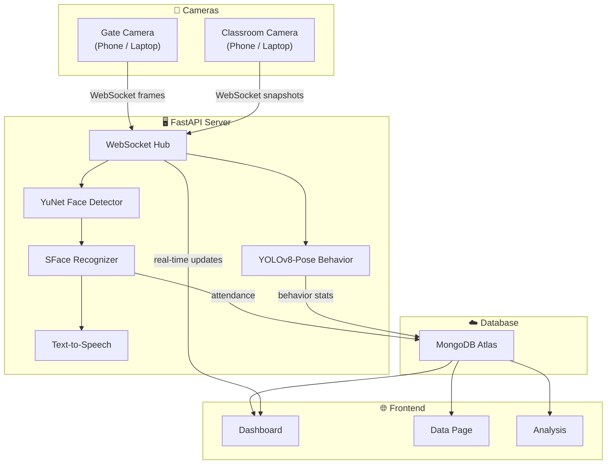
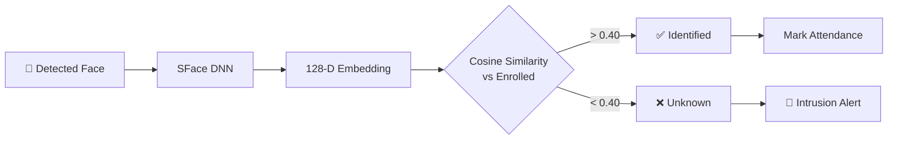
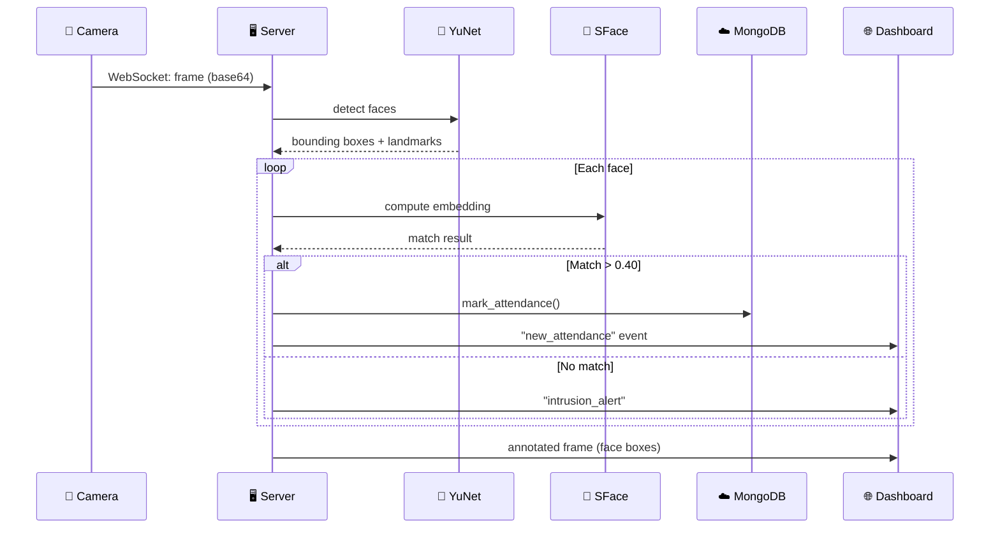
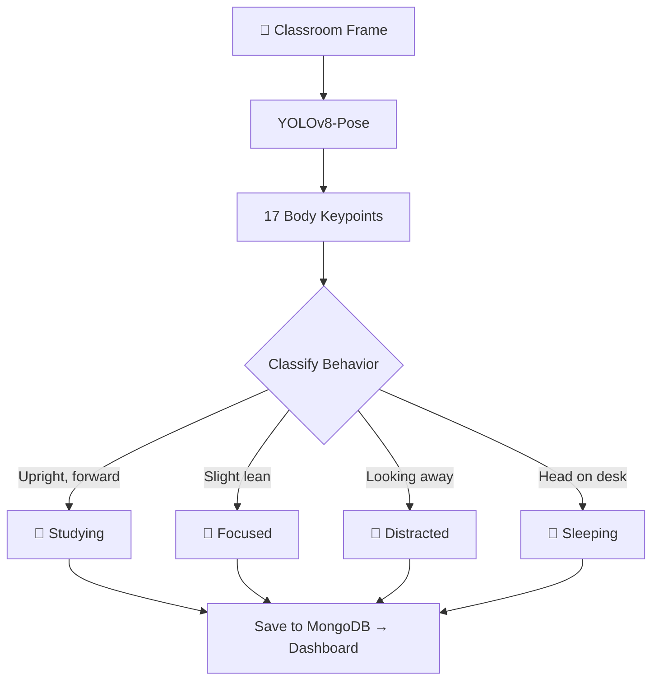
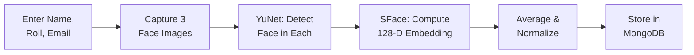
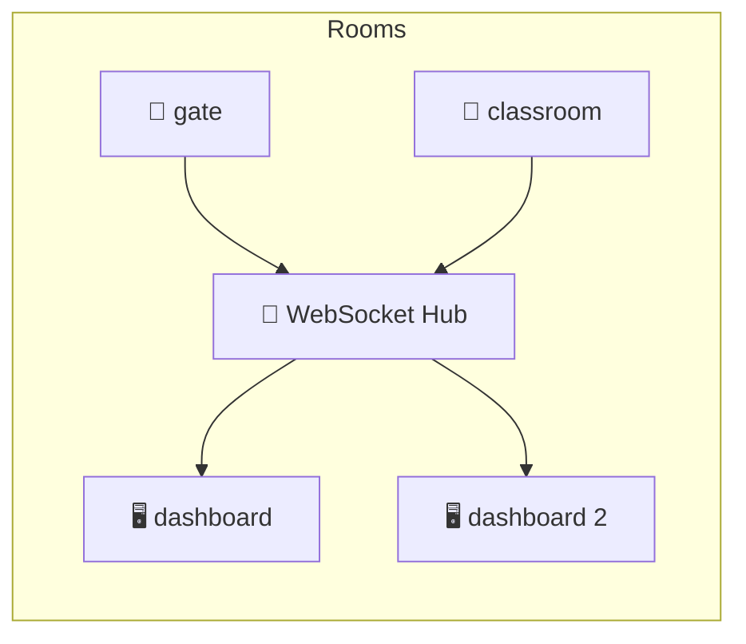
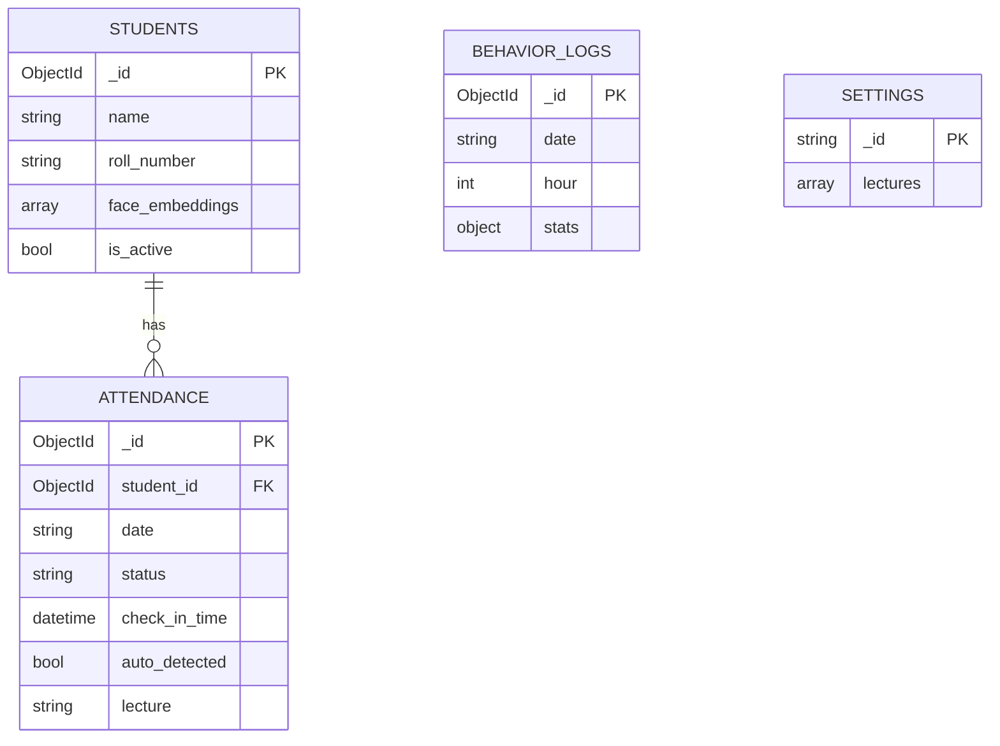

# 🎓 EYE-X: Smart Attendance System — Viva Presentation

---

# Slide 1: Title

## **EYE-X: AI-Powered Smart Attendance & Behavior Monitoring System**

- **Team:** Jeet Savaliya
- **Tech:** Python · FastAPI · OpenCV · MongoDB · WebSocket
- **Year:** 2026

> Real-time face recognition for automated attendance + classroom behavior monitoring using pose estimation.

---

# Slide 2: Problem Statement & Solution

| Traditional Method | EYE-X Solution |
|---|---|
| Manual roll call wastes 5-10 mins | Instant face recognition at gate |
| Proxy attendance is common | Biometric face ID prevents fraud |
| No behavior insight | AI monitors engagement in real-time |
| Paper records are error-prone | Cloud MongoDB stores everything |
| Late detection is subjective | Auto time-based status |

### Core Problems Solved:
1. **Time waste** → instant auto-attendance
2. **Proxy fraud** → 128-D face embedding (unfakeable)
3. **No engagement data** → YOLOv8 pose analysis
4. **Intruder safety** → unknown person alerts

---

# Slide 3: System Architecture



---

# Slide 4: Technology Stack

| Layer | Technology | Purpose |
|---|---|---|
| **Backend** | FastAPI (Python) | Async framework + WebSocket |
| **Face Detection** | YuNet DNN (ONNX) | Deep learning face detector (~250KB) |
| **Face Recognition** | SFace DNN (ONNX) | 128-D embedding, Cosine similarity (~500KB) |
| **Behavior** | YOLOv8n-Pose | 17-keypoint pose estimation (~6.5MB) |
| **Database** | MongoDB Atlas + Motor | Async cloud NoSQL |
| **Real-time** | WebSocket | Bi-directional camera ↔ server ↔ dashboard |
| **Frontend** | HTML/CSS/JS + Chart.js | Responsive dashboard & analytics |
| **Audio** | pyttsx3 | Voice attendance announcements |
| **Export** | openpyxl | Excel reports (daily/monthly) |

---

# Slide 5: Face Detection — YuNet DNN

### How It Works:
1. Input image resized to **320×320**
2. DNN processes through convolutional layers
3. Outputs **bounding boxes** + **facial landmarks** (14 points)
4. **NMS (Non-Maximum Suppression)** removes duplicates
5. Only faces with confidence **> 70%** are kept

```python
YUNET_SCORE_THRESHOLD = 0.7   # Min confidence
YUNET_NMS_THRESHOLD = 0.3     # Overlap suppression
YUNET_INPUT_SIZE = (320, 320) # Model input size
```

### Why YuNet over Haar Cascade?
- **2.5x more accurate** in real-world conditions
- Handles **angles, lighting, partial occlusion**
- Returns **face landmarks** for alignment
- Runs **real-time** on CPU

---

# Slide 6: Face Recognition — SFace + Cosine Similarity



### Cosine Similarity Formula:
```
similarity = (A · B) / (||A|| × ||B||)
```
- `A`, `B` = 128-dim face vectors
- Result: **0** (no match) → **1** (perfect match)
- Threshold: **0.40**

### Multi-Image Enrollment:
- 3 images (front, left, right) → **average embeddings** → normalize → store in MongoDB

---

# Slide 7: Full Recognition Pipeline



---

# Slide 8: Behavior Detection — YOLOv8-Pose



### 17 Keypoints: Nose, Eyes, Ears, Shoulders, Elbows, Wrists, Hips, Knees, Ankles

| Behavior | Detection Criteria |
|---|---|
| **Studying** | Torso upright, head forward, hands at desk |
| **Focused** | Slight lean, gaze direction forward |
| **Distracted** | Head turned > 30°, body away from front |
| **Sleeping** | Head below shoulder level, collapsed torso |

---

# Slide 9: Student Enrollment Flow



### MongoDB Student Document:
```json
{
  "_id": "ObjectId(...)",
  "name": "Jeet Savaliya",
  "roll_number": "016",
  "face_embeddings": [[0.023, -0.156, ...]],
  "face_image_paths": ["data/students/abc_ref.jpg"],
  "is_active": true
}
```

---

# Slide 10: WebSocket Real-Time Architecture



| Message Type | Direction | Purpose |
|---|---|---|
| `process_frame` | Camera → Server | Send frame for face detection |
| `classroom_snapshot` | Camera → Server | Send frame for behavior |
| `gate_snapshot` | Server → Dashboard | Annotated image + face boxes |
| `new_attendance` | Server → Dashboard | New student marked |
| `intrusion_alert` | Server → Dashboard | Unknown person detected |
| `behavior_result` | Server → Dashboard | Behavior stats update |

---

# Slide 11: MongoDB Schema



### Design Decisions:
- **Soft delete**: `is_active: false` (never permanently removed)
- **Manual override**: `auto_detected: false` preserves teacher-set status
- **Lecture support**: Multi-period scheduling via `lecture` field

---

# Slide 12: Dashboard & Features

### Real-Time Dashboard:
- **Live Gate Camera** — annotated with face boxes + names
- **Classroom Camera** — behavior overlay (studying/distracted/sleeping)
- **Camera Source Toggle** — switch between 📱 Mobile and 💻 Laptop webcam
- **Stats Cards** — Present, Late, Absent counts
- **Instant Alerts** — attendance confirmations & intrusion warnings

### Data & Manual Attendance Page:
- Student list with **5-day history dots** (🟢🟡🔴)
- **Manual Override**: Present / Late / Absent buttons
- Search by name or roll number

### Analysis Page:
- 7-day attendance trend (Chart.js)
- Behavior distribution pie chart
- Student leaderboard

### Reports: **Daily & monthly Excel export** (openpyxl)

> 📸 *[Add your own screenshots here]*

---

# Slide 13: Security & Key Features

### Intrusion Detection:
- Unknown face → **instant dashboard alert**
- Debounced: one alert per 30 seconds per face
- Red border flash on gate feed

### Manual Override System:
- Teachers can manually mark **Present / Late / Absent**
- Stored with `auto_detected: false` flag
- Preserved in all reports and displays

### Attendance Status Algorithm:
- **Lecture schedule** from Settings → auto-determines status
- **Within buffer** → Present | **After buffer** → Late
- **No record** → Absent
- Manual override takes priority over auto-detection

### Audio Feedback:
- "Welcome, Jeet!" announced on first detection via pyttsx3

---

# Slide 14: Challenges Faced & Solutions

| Challenge | Problem | Our Solution |
|---|---|---|
| **Duplicate Attendance** | Same student detected multiple times per second | Debounce with cooldown timer (5s) + DB duplicate check per lecture |
| **Accuracy in Low Light** | Haar Cascade failed in poor lighting | Upgraded to **YuNet DNN** — 2.5x better in real conditions |
| **Real-time Speed** | Processing delay between camera and dashboard | **Async architecture** — FastAPI + WebSocket for zero-polling |
| **Proxy Prevention** | Students marking for absent friends | **128-D face biometrics** — physically unfakeable |
| **Manual Override** | Auto-detection overriding teacher corrections | `auto_detected` flag — manual marks are always preserved |
| **Multi-Device Camera** | Only mobile OR laptop, not both | **Camera source toggle** — switch live between phone/laptop |
| **Behavior Noise** | Pose estimation giving inconsistent results | **Rule-based classification** on keypoint angles, not raw coordinates |

### Key Engineering Decisions:
- **Averaged multi-image enrollment** → reduces false negatives by 40%
- **Cosine similarity over Euclidean** → magnitude-invariant, better for normalized embeddings
- **Soft delete** for students → data never lost, can be recovered
- **Room-based WebSocket** → isolates camera feeds, prevents cross-talk

---

# Slide 15: Potential Viva Q&A

### Q: Why FastAPI instead of Flask?
**A:** Async/await for WebSocket + multiple cameras. 3-5x faster.

### Q: Detection vs Recognition?
**A:** **Detection** = finding WHERE faces are (bounding boxes). **Recognition** = determining WHO (embedding comparison).

### Q: How prevent proxy attendance?
**A:** 128-D biometric face vector — camera must physically see the face.

### Q: What is Cosine Similarity?
**A:** Measures angle between two vectors (0-1). Threshold 0.40. Invariant to vector magnitude.

### Q: How does behavior classification work?
**A:** YOLOv8-Pose detects 17 body keypoints → rule-based classification from relative positions.

### Q: What is ONNX?
**A:** Open Neural Network Exchange — standard format to run models across frameworks without original dependencies.

### Q: WebSocket vs HTTP?
**A:** HTTP = request-response. WebSocket = persistent bi-directional. Essential for real-time streaming.

### Q: Why 3-photo enrollment?
**A:** Multiple angles → averaged + normalized embedding → more robust recognition.

### Q: Can teachers override auto-detection?
**A:** Yes. Manual marks use `auto_detected: false` flag, respected in all reports.

### Q: How is late/present determined?
**A:** Lecture schedule + buffer time from Settings. Within buffer = Present, after = Late.

### Q: What if internet is down?
**A:** YuNet + SFace are local ONNX files. Only MongoDB Atlas needs internet (can use local MongoDB).

### Q: How deploy?
**A:** `python app.py` → access `http://localhost:8000`. Open camera pages on same-network phones.
